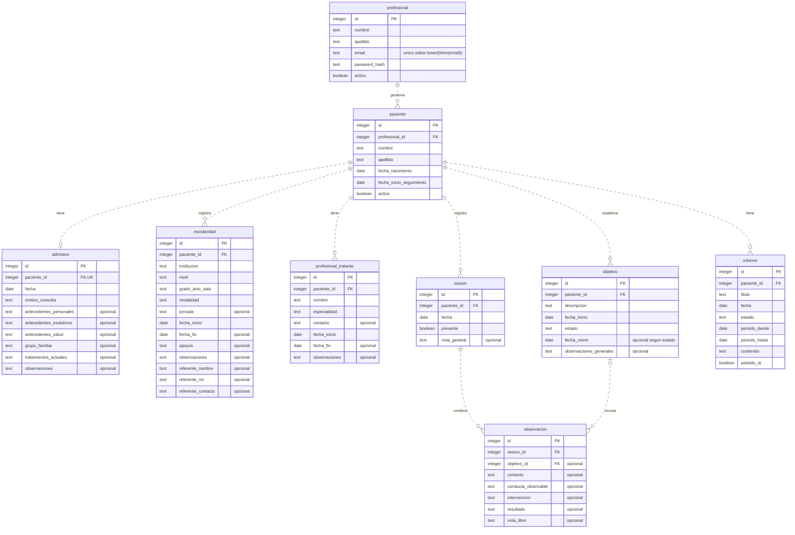

# Backend: API y base de datos

## Entorno de desarrollo

Requiere Python 3.13 y PostgreSQL. Desde la raíz del repositorio, en PowerShell:

```powershell
py -3.13 -m venv backend/.venv
& ./backend/.venv/Scripts/python.exe -m pip install -r backend/requirements-dev.txt
if (-not (Test-Path backend/.env)) { Copy-Item backend/.env.example backend/.env }
# Editar backend/.env con la URL de la base local antes del arranque.
& ./backend/.venv/Scripts/python.exe -m uvicorn app.main:create_app --factory --app-dir backend
```

Si `py` no detecta Python, usar la ruta del ejecutable instalado de Python 3.13 para crear el entorno. No es necesario activar el entorno ni cambiar la política de ejecución de PowerShell.

La documentación interactiva está en `http://127.0.0.1:8000/docs`; el esquema OpenAPI, en `/openapi.json`.

La aplicación se organiza en `app/api`, `core`, `db`, `models`, `schemas`, `services` e `integrations`.

Para instalar solo las dependencias de ejecución, usar `backend/requirements.txt`. Ambos archivos fijan las versiones comprobadas; el entorno virtual y las cachés están ignorados en Git.

## Configuración

`DATABASE_URL` es obligatoria y debe usar `postgresql+psycopg://`, un host y un nombre de base. El ejemplo versionado no contiene credenciales. Incorporar usuario y contraseña locales cuando el servidor lo requiera; codificar los caracteres reservados de la contraseña en la URL.

La configuración se carga desde `backend/.env`, independientemente del directorio actual. Las variables de entorno prevalecen sobre el archivo. No sobrescribir un `.env` existente al repetir la instalación ni subirlo al repositorio.

Una URL ausente o inválida impide iniciar y muestra un mensaje que identifica `DATABASE_URL`, sin su contenido. La URL se conserva como `SecretStr` y no aparece en la representación de la configuración. Con configuración válida, PostgreSQL puede estar caído y la API igualmente inicia.

## Salud y conexión

```powershell
Invoke-RestMethod http://127.0.0.1:8000/api/salud
```

`GET /api/salud` es público y ejecuta `SELECT 1` en cada solicitud:

| HTTP | JSON exacto |
| --- | --- |
| 200 | `{"estado":"ok","postgresql":"conectado"}` |
| 503 | `{"estado":"error","postgresql":"no_disponible"}` |

El endpoint comprueba conectividad; no comprueba la instalación del esquema. No registra datos ni expone excepciones de PostgreSQL. La documentación permanece disponible durante una caída. Al recuperar PostgreSQL, la siguiente solicitud de salud vuelve a funcionar sin reiniciar Uvicorn.

Hay un engine compartido por aplicación y una sesión sincrónica de SQLModel por solicitud. Las sesiones cierran y revierten transacciones pendientes aun ante errores. El engine libera el pool al apagar la aplicación. `pool_pre_ping` descarta conexiones rotas al reutilizarlas.

Se aplican tres límites independientes: conexión `connect_timeout=3`, espera del pool `pool_timeout=3` y consulta PostgreSQL `statement_timeout=3000` milisegundos. No constituyen un plazo total único de tres segundos. El pool permite cinco conexiones y cinco adicionales. El arranque no abre conexiones ni crea tablas ni ejecuta migraciones: el SQL se instala manualmente como se explica abajo.

## Pruebas

Desde la raíz, ejecutar pruebas que no necesitan un servidor PostgreSQL activo:

```powershell
& ./backend/.venv/Scripts/python.exe -m pytest -c backend/pytest.ini -m "not integration" -q
```

Para las pruebas de conexión, preparar una **base PostgreSQL exclusiva de pruebas**, cuyo nombre termine en `_test`, y configurar `TEST_DATABASE_URL`. No es necesario instalar `init.sql` para E1: la salud debe funcionar incluso con una base sin tablas.

```powershell
# Crear una vez en un servidor de pruebas, usando sus datos de conexión:
& 'C:/Program Files/PostgreSQL/17/bin/createdb.exe' -h localhost -p 5432 -U postgres seguimiento_test
$env:TEST_DATABASE_URL = 'postgresql+psycopg://localhost:5432/seguimiento_test'
# Agregar las credenciales locales a la variable si PostgreSQL las requiere.
& ./backend/.venv/Scripts/python.exe -m pytest -c backend/pytest.ini -q
```

Las pruebas sobre `TEST_DATABASE_URL` verifican conexión, cierre y rollback de sesiones, límite de consulta, salud y ausencia de escrituras o DDL. No detienen ese servidor ni borran o inicializan sus tablas. Si falta la variable, se informan como omitidas; eso no acredita la validación de integración.

La prueba adicional de recuperación necesita los binarios de PostgreSQL en `POSTGRES_BIN`:

```powershell
$env:POSTGRES_BIN = 'C:/Program Files/PostgreSQL/17/bin'
& ./backend/.venv/Scripts/python.exe -m pytest -c backend/pytest.ini -q
```

Esa prueba crea su propio cluster temporal en un directorio de pytest, escucha solo en `127.0.0.1` y usa un puerto libre. Arranca Uvicorn con PostgreSQL caído y verifica por HTTP `503 → 200 → 503 → 200`, manteniendo el mismo proceso de API. Solo inicia y detiene ese cluster; termina sus procesos al finalizar. La autenticación sin contraseña se limita a este cluster temporal de pruebas. Si falta `POSTGRES_BIN`, se omite esta prueba con el motivo correspondiente. No apuntar `POSTGRES_BIN` a un directorio de datos: debe contener `initdb`, `pg_ctl` y `createdb`.

Para comprobar E1 completa, configurar **ambas** variables y ejecutar la suite sin pruebas omitidas. Los comandos también funcionan desde `backend` usando `./.venv/Scripts/python.exe -m pytest -q`.

Referencias de implementación: [sesiones SQLModel con FastAPI](https://fastapi.tiangolo.com/tutorial/sql-databases/), [configuración con Pydantic Settings](https://docs.pydantic.dev/latest/concepts/pydantic_settings/) y [recuperación del pool SQLAlchemy](https://docs.sqlalchemy.org/en/21/core/pooling.html).

## Esquema de datos

El esquema de PostgreSQL está definido en [init.sql](init.sql), a partir de la propuesta y del documento de arquitectura de datos de [docs](../docs). Contempla nueve tablas para las cuentas profesionales, los perfiles de pacientes y su seguimiento psicopedagógico.

## Inicialización

Crear previamente una base de datos vacía y ejecutar desde la raíz del repositorio:

```sh
psql -U <usuario> -d <base_de_datos> -v ON_ERROR_STOP=1 -f backend/init.sql
```

El archivo ejecuta la creación dentro de una transacción (`BEGIN` / `COMMIT`). Está preparado para ejecutarse una sola vez: si las tablas ya existen, la operación falla. Las modificaciones posteriores deben realizarse mediante migraciones.

## Diagrama entidad-relación

`PK` indica clave primaria, `FK` clave foránea y `UK` unicidad. Los atributos marcados como `opcional` aceptan `NULL`. El correo tiene un índice único sobre su expresión normalizada, explicado más adelante.



## Relaciones y claves foráneas

Las cardinalidades indican cuántos registros hijos puede tener cada padre. Cada hijo referencia obligatoriamente a un padre, salvo `observacion.objetivo_id`, que puede ser `NULL`.

| Relación padre → hijo | Cardinalidad | Clave foránea | Constraint |
| --- | --- | --- | --- |
| `profesional` → `paciente` | 1 → 0..N | `paciente.profesional_id` → `profesional.id` | `fk_paciente_profesional` |
| `paciente` → `admision` | 1 → 0..1 | `admision.paciente_id` → `paciente.id` | `fk_admision_paciente` |
| `paciente` → `escolaridad` | 1 → 0..N | `escolaridad.paciente_id` → `paciente.id` | `fk_escolaridad_paciente` |
| `paciente` → `profesional_tratante` | 1 → 0..N | `profesional_tratante.paciente_id` → `paciente.id` | `fk_profesional_tratante_paciente` |
| `paciente` → `objetivo` | 1 → 0..N | `objetivo.paciente_id` → `paciente.id` | `fk_objetivo_paciente` |
| `paciente` → `sesion` | 1 → 0..N | `sesion.paciente_id` → `paciente.id` | `fk_sesion_paciente` |
| `paciente` → `informe` | 1 → 0..N | `informe.paciente_id` → `paciente.id` | `fk_informe_paciente` |
| `sesion` → `observacion` | 1 → 0..N | `observacion.sesion_id` → `sesion.id` | `fk_observacion_sesion` |
| `objetivo` → `observacion` | 1 → 0..N; objetivo opcional para cada observación | `observacion.objetivo_id` → `objetivo.id` | `fk_observacion_objetivo` |

Todas las claves foráneas usan `ON DELETE RESTRICT`: PostgreSQL rechaza borrar un padre mientras existan hijos que lo referencien. No se realizan borrados en cascada. Esto incluye los objetivos vinculados a observaciones. Para conservar el historial, profesionales y pacientes pueden desactivarse con `activo = FALSE`.

No se declara `ON UPDATE`, por lo que se aplica `NO ACTION`: un cambio de ID debe seguir respetando las referencias existentes. Las restricciones no son diferibles.

`profesional_tratante` representa contactos externos del paciente. Sus registros no otorgan acceso a la aplicación ni se vinculan con las cuentas de `profesional`.

## Constraints de integridad

### Claves primarias y generación de identificadores

Las nueve tablas tienen `id INTEGER GENERATED BY DEFAULT AS IDENTITY PRIMARY KEY`. La clave primaria exige un valor único y no nulo. PostgreSQL genera el ID cuando se omite en un `INSERT`; `BY DEFAULT` también permite proporcionar un ID explícito. La API debe dejar que la base genere los identificadores nuevos.

### Campos obligatorios y opcionales

Todas las columnas son `NOT NULL`, excepto las enumeradas en esta tabla. Un valor por defecto permite omitir una columna al insertar, pero no permite asignarle `NULL` si es obligatoria.

| Tabla | Columnas que aceptan `NULL` |
| --- | --- |
| `profesional` | Ninguna |
| `paciente` | Ninguna |
| `admision` | `antecedentes_personales`, `antecedentes_evolutivos`, `antecedentes_salud`, `grupo_familiar`, `tratamientos_actuales`, `observaciones` |
| `escolaridad` | `jornada`, `fecha_fin`, `apoyos`, `observaciones`, `referente_nombre`, `referente_rol`, `referente_contacto` |
| `profesional_tratante` | `contacto`, `fecha_fin`, `observaciones` |
| `objetivo` | `fecha_cierre`, `observaciones_generales` |
| `sesion` | `nota_general` |
| `observacion` | `objetivo_id`, `contexto`, `conducta_observable`, `intervencion`, `resultado`, `nota_libre` |
| `informe` | Ninguna |

En `objetivo`, la posibilidad de dejar `fecha_cierre` en `NULL` depende del estado. En `observacion`, los campos de contenido son opcionales individualmente, pero al menos uno debe contener texto.

### Unicidad

| Tabla / índice | Regla |
| --- | --- |
| `admision.paciente_id UNIQUE` | Cada paciente puede tener una sola admisión. Combinado con `NOT NULL` y la FK, impide duplicados y admisiones sin paciente. |
| `uq_profesional_email` | Índice único sobre `lower(btrim(email))`. Rechaza correos equivalentes al ignorar mayúsculas y espacios en los extremos. Por ejemplo, `Profesional@example.com` y ` profesional@example.com ` se consideran iguales. |

El índice del correo compara la expresión normalizada; no modifica el texto almacenado ni valida el formato de una dirección de correo electrónico.

### Texto no vacío

Estos campos tienen `CHECK (btrim(campo) <> '')`, además de `NOT NULL`. Rechazan la cadena vacía y las cadenas compuestas únicamente por espacios. `btrim` con su configuración predeterminada no elimina todos los tipos de espacio en blanco, como tabulaciones o saltos de línea.

| Tabla | Campos |
| --- | --- |
| `profesional` | `nombre`, `apellido`, `email`, `password_hash` |
| `paciente` | `nombre`, `apellido` |
| `admision` | `motivo_consulta` |
| `escolaridad` | `institucion`, `nivel`, `grado_anio_sala`, `modalidad` |
| `profesional_tratante` | `nombre`, `especialidad` |
| `objetivo` | `descripcion` |
| `informe` | `titulo`, `contenido` |

### Fechas, estados y contenido

| Constraint | Regla aplicada por PostgreSQL |
| --- | --- |
| `ck_paciente_fechas` | `fecha_inicio_seguimiento >= fecha_nacimiento`. |
| `ck_escolaridad_fechas` | `fecha_fin IS NULL OR fecha_fin >= fecha_inicio`. Una fecha final nula indica un período vigente. |
| `ck_profesional_tratante_fechas` | `fecha_fin IS NULL OR fecha_fin >= fecha_inicio`. Una fecha final nula indica una intervención vigente. |
| `ck_objetivo_estado` | `estado` admite únicamente `activo`, `cumplido` o `cerrado`. |
| `ck_objetivo_fechas` | `fecha_cierre IS NULL OR fecha_cierre >= fecha_inicio`. |
| `ck_objetivo_cierre` | Un objetivo `activo` debe tener `fecha_cierre = NULL`. Uno `cumplido` o `cerrado` debe tener fecha de cierre. Al cerrarlo, estado y fecha deben actualizarse en la misma sentencia. |
| `ck_observacion_contenido` | Al menos uno de `contexto`, `conducta_observable`, `intervencion`, `resultado` o `nota_libre` debe ser distinto de `NULL`, vacío o solo espacios, según `nullif(btrim(campo), '')`. |
| `ck_informe_estado` | `estado` admite únicamente `borrador` o `finalizado`. |
| `ck_informe_periodo` | `periodo_hasta >= periodo_desde`. |

Los valores de los estados son decisiones iniciales de `init.sql`, ya que los PDF no fijan su enumeración. `cerrado` representa el cierre de un objetivo sin cumplimiento; `finalizado` representa un informe revisado por el profesional. La base controla esos valores, pero la revisión efectiva del contenido corresponde al flujo de la aplicación.

### Valores por defecto

| Columna | Valor por defecto |
| --- | --- |
| `profesional.activo` | `TRUE` |
| `paciente.activo` | `TRUE` |
| `objetivo.estado` | `'activo'` |
| `informe.fecha` | `CURRENT_DATE` |
| `informe.estado` | `'borrador'` |
| `informe.asistido_ia` | `FALSE` |

`sesion.presente` es obligatorio y no tiene valor por defecto: debe indicarse expresamente si el paciente asistió. Una sesión puede existir sin observaciones, por ejemplo ante una ausencia.

## Índices de consulta

Además de los índices que PostgreSQL crea para las claves primarias y `admision.paciente_id UNIQUE`, el esquema declara los siguientes:

| Índice | Columnas / expresión | Propósito |
| --- | --- | --- |
| `uq_profesional_email` | `lower(btrim(email))` | Garantizar la unicidad del correo normalizado. |
| `idx_paciente_profesional_nombre` | `profesional_id, apellido, nombre` | Listar los pacientes de un profesional por apellido y nombre. |
| `idx_escolaridad_paciente_fecha` | `paciente_id, fecha_inicio DESC` | Consultar períodos escolares por paciente y fecha. |
| `idx_profesional_tratante_paciente` | `paciente_id` | Recuperar contactos externos del paciente. |
| `idx_objetivo_paciente_estado` | `paciente_id, estado` | Consultar objetivos por paciente y estado. |
| `idx_sesion_paciente_fecha` | `paciente_id, fecha DESC, id DESC` | Consultar sesiones en orden temporal, con desempate por ID. |
| `idx_observacion_sesion` | `sesion_id` | Recuperar las observaciones de una sesión. |
| `idx_observacion_objetivo` | `objetivo_id` | Recuperar las observaciones vinculadas a un objetivo. |
| `idx_informe_paciente_fecha` | `paciente_id, fecha DESC, id DESC` | Consultar informes del paciente en orden temporal. |

Los índices de consulta no agregan restricciones de unicidad, salvo `uq_profesional_email`.

## Validaciones a implementar en el backend

Las siguientes reglas requieren validación en la API y sus servicios; `init.sql` no las garantiza por sí solo:

- Comprobar que el paciente pertenece al profesional autenticado antes de consultar o modificar su información. La pertenencia de los registros hijos se obtiene a través de `paciente`; no repiten `profesional_id`.
- Comprobar que el objetivo vinculado a una observación pertenece al mismo paciente que su sesión. Las dos FK verifican que los registros existan, pero no que sus pacientes coincidan. La validación también debe realizarse al cambiar los vínculos o reasignar objetivos y sesiones a otro paciente.
- Calcular el hash de la contraseña antes de guardar `password_hash`. Su constraint solo exige texto no vacío; no comprueba el algoritmo ni que el contenido sea un hash.
- Validar formatos de entrada, como el correo electrónico, y convertir a `NULL` los campos opcionales vacíos del frontend, especialmente las fechas.
- Aplicar la revisión profesional de transcripciones e informes antes de confirmar el contenido correspondiente.

La correspondencia de campos del frontend es `fechaNacimiento` → `fecha_nacimiento` y `fechaInicio` → `fecha_inicio_seguimiento`. Los demás campos actuales de admisión y escolaridad ya usan los nombres del esquema.

## Criterios de persistencia

La cronología se construye mediante consultas de sesiones y observaciones ordenadas por fecha. La evolución de un objetivo se obtiene a partir de sus observaciones vinculadas y las fechas de sus sesiones.

El audio se procesa temporalmente; solo se guarda el texto confirmado en `sesion.nota_general` o en los campos de `observacion`. Los informes conservan contenido editable, período, estado y la marca `asistido_ia`.

El esquema permite varias escolaridades vigentes simultáneamente. La decisión de restringirlas a una sola quedó abierta en el documento de arquitectura y no se agregó una restricción al respecto.
