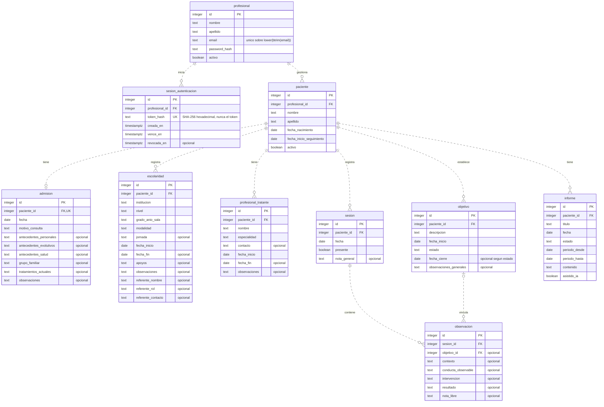

# Backend: API y base de datos

## Entorno de desarrollo

Requiere Python 3.13 y PostgreSQL. Desde la raíz del repositorio, en PowerShell:

```powershell
py -3.13 -m venv backend/.venv
& ./backend/.venv/Scripts/python.exe -m pip install -r backend/requirements-dev.txt
if (-not (Test-Path backend/.env)) { Copy-Item backend/.env.example backend/.env }
# Editar backend/.env con la URL de la base local antes del arranque.
& ./backend/.venv/Scripts/python.exe -m uvicorn app.main:create_app --factory --app-dir backend
```

Si `py` no detecta Python, usar la ruta del ejecutable instalado de Python 3.13 para crear el entorno. No es necesario activar el entorno ni cambiar la política de ejecución de PowerShell.

La documentación interactiva está en `http://127.0.0.1:8000/docs`; el esquema OpenAPI, en `/openapi.json`.

La aplicación se organiza en `app/api`, `core`, `db`, `models`, `schemas`, `services` e `integrations`.

Para instalar solo las dependencias de ejecución, usar `backend/requirements.txt`. Ambos archivos fijan las versiones comprobadas; el entorno virtual y las cachés están ignorados en Git.

## Configuración

`DATABASE_URL` es obligatoria y debe usar `postgresql+psycopg://`, un host y un nombre de base. El ejemplo versionado no contiene credenciales. Incorporar usuario y contraseña locales cuando el servidor lo requiera; codificar los caracteres reservados de la contraseña en la URL.

La configuración se carga desde `backend/.env`, independientemente del directorio actual. Las variables de entorno prevalecen sobre el archivo. No sobrescribir un `.env` existente al repetir la instalación ni subirlo al repositorio.

Una URL ausente o inválida impide iniciar y muestra un mensaje que identifica `DATABASE_URL`, sin su contenido. La URL se conserva como `SecretStr` y no aparece en la representación de la configuración. Con configuración válida, PostgreSQL puede estar caído y la API igualmente inicia.

`ALLOWED_ORIGINS` es una lista JSON de orígenes completos, sin rutas, barras finales ni comodines. Por defecto permite `http://localhost:5173` y `http://127.0.0.1:5173`. CORS habilita credenciales para esos orígenes explícitos. Las operaciones POST/PUT/PATCH/DELETE rechazan con `403` un `Origin` distinto de los permitidos o del origen de la API; los clientes sin ese encabezado, como CLI y Swagger, pueden operar.

`SESSION_COOKIE_SECURE` es `false` para desarrollo HTTP local; usar `true` en producción con HTTPS. Copiar las opciones del ejemplo a la configuración local cuando corresponda; la aplicación no modifica `.env`.

## Autenticación

Antes de usarla, instalar el esquema nuevo o aplicar la migración manual descrita más abajo. El registro crea cuentas con nombre/apellido recortados, correo recortado y en minúsculas, y contraseña de 8 a 1024 caracteres, sin recortar sus espacios. La contraseña se guarda con Argon2 mediante [pwdlib](https://frankie567.github.io/pwdlib/). Las respuestas solo incluyen `id`, `nombre`, `apellido`, `email` y `activo`.

| Método | Ruta | Resultado |
| --- | --- | --- |
| POST | `/api/auth/registro` | JSON `nombre`, `apellido`, `email`, `password`; crea una cuenta (`201`), sin iniciar sesión. Correo duplicado: `409`. |
| POST | `/api/auth/login` | JSON `email`, `password`; devuelve el profesional público (`200`) y establece cookie. Credenciales inválidas o profesional inactivo: `401` con el mismo mensaje. |
| GET | `/api/auth/me` | Profesional de la sesión actual (`200`); sesión ausente, vencida, revocada o profesional inactivo: `401`. |
| POST | `/api/auth/logout` | Revoca solo la sesión actual y elimina cookie (`204`, sin cuerpo). Sesión inválida: `401`. |

Cada login genera un token aleatorio de 256 bits; PostgreSQL conserva solo su SHA-256 en `sesion_autenticacion`. La sesión dura ocho horas, sin renovación automática. La cookie `sesion` usa `HttpOnly`, `SameSite=Lax`, `Path=/`, `Max-Age=28800` y `Secure` según configuración. El token no se devuelve en JSON. Las consultas protegidas verifican sesión y cuenta activa en cada solicitud.

Pacientes, admisión, escolaridad, profesionales tratantes y objetivos requieren una sesión y limitan sus operaciones al profesional autenticado. Los recursos ajenos o inexistentes responden `404`. Se eliminó el profesional de prueba fijo; los contactos tratantes siguen sin otorgar acceso. Salud, registro y login son públicos, igual que `/docs` y OpenAPI. Los errores de validación no incluyen los valores recibidos; los errores de base no exponen consultas ni credenciales.

Para probarlo desde PowerShell, registrar primero una cuenta por `/docs`. Después usar su correo y contraseña elegida:

```powershell
$credenciales = @{ email = 'profesional@example.com'; password = '<contraseña elegida>' } | ConvertTo-Json
Invoke-RestMethod http://127.0.0.1:8000/api/auth/login -Method Post -ContentType 'application/json' -Body $credenciales -SessionVariable sesionApi
Invoke-RestMethod http://127.0.0.1:8000/api/auth/me -WebSession $sesionApi
Invoke-RestMethod http://127.0.0.1:8000/api/pacientes -WebSession $sesionApi
Invoke-RestMethod http://127.0.0.1:8000/api/auth/logout -Method Post -WebSession $sesionApi
```

El frontend incorporado por los PR #12/#13 incluye registro/login/logout, cookies y manejo de 401. En desarrollo usa el proxy de Vite (`/api` hacia `http://127.0.0.1:8000`) para conservar el host visible de la cookie. Desde la raíz, `npm.cmd run dev` inicia ambos procesos; requiere las dependencias de frontend y backend instaladas y la base inicializada. La integración completa desde el navegador se valida por separado de las pruebas de API. Los contratos están en [CONTRATOS.md](CONTRATOS.md).

## Pacientes y perfil

Todas estas rutas requieren sesión y limitan los datos al profesional autenticado.
`P` representa `/api/pacientes/{paciente_id}`; un recurso ajeno, inexistente o
perteneciente a otro paciente de la ruta responde `404`.

| Métodos | Ruta | Resultado |
| --- | --- | --- |
| GET, POST | `/api/pacientes` | Lista paginada o creación con `201`. |
| GET, PATCH | `P` | Consultar/editar; `activo=false` desactiva sin borrar historial. |
| GET, PUT | `P/admision` | Ausente: `404`; crear: `201`; reemplazar: `200`, conservando ID y admisión única. |
| GET, POST | `P/escolaridades` | Lista paginada o creación con `201`; admite varias vigentes. |
| GET, PATCH | `P/escolaridades/{escolaridad_id}` | Consulta o edición parcial. |
| GET, POST | `P/profesionales-tratantes` | Lista paginada o creación con `201`; no crea cuentas ni permisos. |
| GET, PATCH | `P/profesionales-tratantes/{profesional_tratante_id}` | Consulta o edición parcial. |

Las listas de pacientes, escolaridades y contactos devuelven siempre
`{"items": [], "total": 0, "offset": 0, "limit": 20}` con sus valores reales.
`offset` es no negativo y `limit` va de 1 a 100 (por defecto 20). `total` cuenta
solo los datos autorizados antes de paginar. Pacientes ordena apellido/nombre/ID
ascendentes e incluye inactivos; períodos y contactos, inicio/ID descendentes.

Los cuerpos usan snake_case y fechas `YYYY-MM-DD`. La API genera identidad y
pertenencia desde PostgreSQL/sesión/ruta; no acepta IDs ni reasignaciones en los
cuerpos. PATCH conserva campos omitidos, permite null solo en opcionales y
valida el registro completo resultante antes de modificarlo. Un PATCH vacío no
cambia datos. Texto obligatorio se recorta y no admite vacío; texto opcional
vacío y fecha final vacía se convierten a null. Las fechas respetan el orden
del SQL. Una edición inválida responde 422 y conserva los datos previos.

Los PUT individuales de escolaridades/contactos se conservan para reemplazo
completo, marcados como deprecados en OpenAPI. Los opcionales omitidos en PUT
quedan en null; no tienen semántica parcial. No hay DELETE de dominio. Las
escrituras revierten ante errores y los conflictos de integridad responden 409
sin SQL ni datos recibidos. La creación concurrente de la misma admisión
mantiene un único registro.

Las pruebas del perfil y la adaptación requerida de consumidores externos se
describen en [CONTRATOS.md](CONTRATOS.md); este trabajo no modifica el frontend.

## Objetivos

`GET P/objetivos` devuelve la misma página `items/total/offset/limit` del perfil,
ordenada por fecha de inicio e ID descendentes. `POST` crea con 201;
`GET/PATCH P/objetivos/{objetivo_id}` consultan/editan el objetivo del paciente
autorizado. El PUT anterior se conserva deprecado para reemplazo completo.

Estados: `activo`, `cumplido`, `cerrado`. Un activo no tiene fecha de cierre;
los otros estados requieren cierre no anterior al inicio. Para cerrar, enviar
estado y fecha en el mismo PATCH; para reabrir, `estado=activo` y
`fecha_cierre=null`. Se valida el registro completo antes de escribir y la
transición se guarda en una transacción. Los campos omitidos conservan valor;
los opcionales vacíos pasan a null. No hay reasignaciones de paciente ni DELETE.

## Sesiones, observaciones y evidencias

Estas rutas requieren sesión de acceso y verifican paciente, sesión de seguimiento
y registros hijos dentro del mismo propietario.

| Métodos | Ruta | Resultado |
| --- | --- | --- |
| GET, POST | `P/sesiones` | Lista paginada por fecha/ID descendentes; crear con 201. |
| GET, PATCH | `P/sesiones/{sesion_id}` | Consultar/editar fecha, asistencia y nota general. |
| GET, POST | `P/sesiones/{sesion_id}/observaciones` | Lista paginada por ID ascendente; crear con 201. |
| GET, PATCH | `P/sesiones/{sesion_id}/observaciones/{observacion_id}` | Consultar/editar contenido y objetivo opcional. |
| GET | `P/objetivos/{objetivo_id}/observaciones` | Evidencias paginadas por fecha de sesión e ID de observación descendentes. |

Una sesión exige `fecha` y `presente` booleano explícito; admite ausencias y cero
observaciones. `nota_general` es opcional. No se crea contenido automáticamente.

Las observaciones contienen `contexto`, `conducta_observable`, `intervencion`,
`resultado` y `nota_libre`: al menos uno debe tener texto después de normalizar
vacíos a null. `objetivo_id` es opcional y debe ser un entero positivo del mismo
paciente que la sesión; null lo desvincula. Se verifica al crear y editar, incluso
entre pacientes del mismo profesional. PATCH valida el resultado completo antes
de modificar; no acepta reasignar sesión, paciente o identidad en el cuerpo.

Las evidencias incluyen los campos de observación más `fecha_sesion`, calculada
desde la sesión actual. Solo se consultan observaciones vinculadas al objetivo
autorizado y a sesiones de ese paciente. No se duplican fuentes ni se guarda una
tabla de evidencias. Sesión/observación se editan mediante PATCH; no hay PUT ni
DELETE para esos recursos nuevos. Desactivar al paciente conserva todo el historial.

## Cronología

`GET P/cronologia` requiere sesión y devuelve una página de sesiones con sus
observaciones. Cada item incluye `id`, `paciente_id`, `fecha`, `presente`,
`nota_general` y `observaciones` (campos de `ObservacionRespuesta`). Se incluyen
ausencias y sesiones sin observaciones; estas últimas llevan una lista vacía.

Parámetros opcionales: `desde` y `hasta` en formato `YYYY-MM-DD`, ambos inclusivos
sobre la fecha de sesión. Un intervalo invertido o una fecha inválida responde
422. Orden: fecha/ID de sesión descendentes y observaciones por ID ascendente.
Usa los mismos `offset`/`limit` del perfil; `total` cuenta sesiones filtradas antes
de paginar. Una sesión conserva todas sus observaciones dentro de su página.

Ejemplo: `GET P/cronologia?desde=2026-01-01&hasta=2026-01-31&offset=0&limit=20`.
La consulta deriva de los registros actuales, sin tabla de cronología ni copias
de fuentes. Los cambios en sesiones/observaciones aparecen al consultar y
desactivar al paciente conserva el acceso a su historial. La interfaz existente
todavía arma su cronología mediante sesiones/observaciones; adoptar este endpoint
con filtros corresponde al trabajo de frontend.

## Informes manuales

`GET/POST P/informes` permite listar y crear informes del paciente autorizado;
`GET/PATCH P/informes/{informe_id}` consulta o edita un informe individual.
La creación responde 201 y la lectura/edición 200. Las listas usan
`items/total/offset/limit`, ordenadas por
fecha e ID descendentes. No se necesita un proveedor de audio ni de IA.

El cuerpo de creación requiere `titulo`, `periodo_desde`, `periodo_hasta` y
`contenido`. `fecha` es opcional y toma la fecha local del servidor por defecto.
Título y contenido se recortan y deben contener texto. Las fechas usan
`YYYY-MM-DD`; el final del período no puede ser anterior al inicio (422).
El período puede abarcar un solo día o no contener sesiones.

Todo informe se crea como `borrador`, con `asistido_ia=false` por defecto. El
contrato permite indicar `asistido_ia=true` al guardar contenido revisado que
recibió asistencia; esa marca no genera texto ni certifica su origen. No se
puede crear directamente un informe `finalizado`. La base genera el ID y el
paciente procede de la ruta; no se aceptan IDs o propietarios en el cuerpo.
No hay DELETE ni copias de filas de sesiones/observaciones dentro de informes.

PATCH conserva campos omitidos y rechaza null en todos los campos del informe.
Valida el período completo resultante antes de escribir; para mover ambos extremos,
enviarlos juntos. Un PATCH vacío no cambia el registro. Editar texto no finaliza
el informe: enviar explícitamente `{"estado":"finalizado"}` después de revisarlo.
Los informes finalizados siguen siendo editables; se puede volver a `borrador`
mediante PATCH explícito. No se implementa una firma ni un bloqueo irreversible.
Editar/finalizar un informe no cambia las sesiones u observaciones utilizadas
como fuente. Estado y demás cambios se guardan en la misma transacción.

## Preparación de audio e IA (E6)

Estas rutas están preparadas para recibir adaptadores reales, pero no hay un
proveedor elegido ni configurado por defecto. Las dependencias
`obtener_transcriptor`/`obtener_generador_informes` devuelven None; los adaptadores
simulados están únicamente en pruebas. En ejecución normal ambas rutas responden
503: `{"detail":"Servicio externo no configurado"}`. Una falla o una respuesta
vacía/inválida de un adaptador responde 503: `{"detail":"Servicio externo no disponible"}`.
Los errores privados del proveedor no se devuelven ni se registran.

| Método | Ruta | Contrato |
| --- | --- | --- |
| POST | `/api/transcripciones` | Multipart con archivo `audio`; 200 con `{"texto":"..."}` editable. |
| POST | `P/informes/generar` | JSON de título/período; 200 con borrador editable, sin ID ni guardado automático. |

Ambas requieren sesión y cuenta activa; generar verifica además paciente propio.
La transcripción no crea registros: se revisa/corrige/descarta en la interfaz y
solo se guarda el texto confirmado mediante los endpoints de sesiones u
observaciones. Un archivo vacío con proveedor configurado o un archivo ausente
responde 422. Nombre/MIME son metadatos; el futuro proveedor valida el formato y
decodifica el audio. El stream y su spool temporal se cierran al terminar o fallar.
Los adaptadores reales deberán fijar timeouts y limpiar cualquier temporal propio.

La generación recibe `titulo`, `periodo_desde` y `periodo_hasta`, con fechas ISO
e intervalo inclusivo válido. Se recogen todas las sesiones del período con sus
observaciones y los objetivos propios vinculados, sin truncar por la paginación
de listas. Las fuentes son copias públicas separadas de ORM. Si no hay sesiones,
el contexto está vacío: el adaptador debe informar insuficiencia de registros sin
inventar hechos ni diagnósticos. La aplicación devuelve `estado=borrador` y
`asistido_ia=true`, fecha local del servidor y contenido editable; no modifica las
fuentes ni guarda un informe. Después de revisarlo, usar `POST P/informes`.

Para recibir multipart se agregó `python-multipart` a los requisitos. Actualizar
el entorno existente desde la raíz:

```powershell
& ./backend/.venv/Scripts/python.exe -m pip install -r backend/requirements.txt
```

Los protocolos de `app/integrations/contratos.py` y sus dependencias definen los
puntos de conexión. No se agregaron variables de proveedor ni credenciales a E6.
Elegir proveedores, implementar sus adaptadores y demostrar el recorrido real
pertenece a MVP-T01/T02/T03; E6 no implica transcripción o generación de IA reales.
El registro manual y las consultas siguen funcionando si una integración falla.
Los cuerpos, respuestas y el flujo de revisión/guardado están en CONTRATOS.md.

## Salud y conexión

```powershell
Invoke-RestMethod http://127.0.0.1:8000/api/salud
```

`GET /api/salud` es público y ejecuta `SELECT 1` en cada solicitud:

| HTTP | JSON exacto |
| --- | --- |
| 200 | `{"estado":"ok","postgresql":"conectado"}` |
| 503 | `{"estado":"error","postgresql":"no_disponible"}` |

El endpoint comprueba conectividad; no comprueba la instalación del esquema. No registra datos ni expone excepciones de PostgreSQL. La documentación permanece disponible durante una caída. Al recuperar PostgreSQL, la siguiente solicitud de salud vuelve a funcionar sin reiniciar Uvicorn.

Hay un engine compartido por aplicación y una sesión sincrónica de SQLModel por solicitud. Las sesiones cierran y revierten transacciones pendientes aun ante errores. El engine libera el pool al apagar la aplicación. `pool_pre_ping` descarta conexiones rotas al reutilizarlas.

Se aplican tres límites independientes: conexión `connect_timeout=3`, espera del pool `pool_timeout=3` y consulta PostgreSQL `statement_timeout=3000` milisegundos. No constituyen un plazo total único de tres segundos. El pool permite cinco conexiones y cinco adicionales. El arranque no abre conexiones ni crea tablas ni ejecuta migraciones: el SQL se instala manualmente como se explica abajo.

## Pruebas

Desde la raíz, ejecutar pruebas que no necesitan un servidor PostgreSQL activo:

```powershell
& ./backend/.venv/Scripts/python.exe -m pytest -c backend/pytest.ini -m "not integration" -q
```

Para las pruebas de conexión, preparar una **base PostgreSQL exclusiva de pruebas**, cuyo nombre termine en `_test`, y configurar `TEST_DATABASE_URL`. No es necesario instalar `init.sql` para E1: la salud debe funcionar incluso con una base sin tablas.

```powershell
# Crear una vez en un servidor de pruebas, usando sus datos de conexión:
& 'C:/Program Files/PostgreSQL/17/bin/createdb.exe' -h localhost -p 5432 -U postgres seguimiento_test
$env:TEST_DATABASE_URL = 'postgresql+psycopg://localhost:5432/seguimiento_test'
# Agregar las credenciales locales a la variable si PostgreSQL las requiere.
& ./backend/.venv/Scripts/python.exe -m pytest -c backend/pytest.ini -q
```

Las pruebas sobre `TEST_DATABASE_URL` verifican conexión, cierre y rollback de sesiones, límite de consulta, salud y ausencia de escrituras o DDL. No detienen ese servidor ni borran o inicializan sus tablas. Si falta la variable, se informan como omitidas; eso no acredita la validación de integración.

La prueba adicional de recuperación necesita los binarios de PostgreSQL en `POSTGRES_BIN`:

```powershell
$env:POSTGRES_BIN = 'C:/Program Files/PostgreSQL/17/bin'
& ./backend/.venv/Scripts/python.exe -m pytest -c backend/pytest.ini -q
```

Esa prueba crea su propio cluster temporal en un directorio de pytest, escucha solo en `127.0.0.1` y usa un puerto libre. Arranca Uvicorn con PostgreSQL caído y verifica por HTTP `503 → 200 → 503 → 200`, manteniendo el mismo proceso de API. Solo inicia y detiene ese cluster; termina sus procesos al finalizar. La autenticación sin contraseña se limita a este cluster temporal de pruebas. Si falta `POSTGRES_BIN`, se omite esta prueba con el motivo correspondiente. No apuntar `POSTGRES_BIN` a un directorio de datos: debe contener `initdb`, `pg_ctl` y `createdb`.

Para comprobar E1 completa, configurar **ambas** variables y ejecutar la suite sin pruebas omitidas. Los comandos también funcionan desde `backend` usando `./.venv/Scripts/python.exe -m pytest -q`.

### Suite completa con PostgreSQL temporal exclusivo

Para comprobar salud, autenticación, perfil y seguimiento sin elegir una base de datos ni tocar la de trabajo:

```powershell
$env:POSTGRES_BIN = 'C:/Program Files/PostgreSQL/17/bin'
& ./backend/.venv/Scripts/python.exe backend/tests/run_postgres_tests.py
```

El runner crea un cluster temporal con un puerto libre, configura `TEST_DATABASE_URL` y ejecuta toda la suite. Lo detiene al finalizar y conserva los temporales para diagnóstico. Los argumentos opcionales se pasan a pytest (por ejemplo, `backend/tests/test_auth_migration.py`). Se requiere permiso local para iniciar los binarios de PostgreSQL.

Las pruebas de autenticación crean y eliminan únicamente schemas aleatorios propios dentro de la base exclusiva `_test`; no inicializan `public`. Cubren la instalación nueva de diez tablas, migración desde el SQL previo con datos existentes, restricciones, hash Argon2, cookies, registro/login/perfil/logout, vencimiento/revocación/inactividad y aislamiento de dos profesionales en todos los recursos actuales. La prueba de recuperación HTTP sigue creando su propio cluster independiente.

Los módulos `test_profile_*` agregan validaciones, contratos OpenAPI, paginación,
persistencia de pacientes/admisión/períodos/contactos, conservación de historial,
edición parcial y reemplazo completo, restricciones PostgreSQL, rollback,
concurrencia de admisión y aislamiento entre propietarios y padres. Se ejecutan
con el mismo runner; para seleccionarlos, pasar sus rutas como argumentos.

`test_objectives.py` y `test_tracking_*` verifican estados/cierres atómicos,
sesiones con asistencia explícita, observaciones con contenido mínimo, vínculos
del mismo paciente, evidencia ordenada, restricciones SQL y conservación del
historial. Las pruebas globales de autenticación también cubren todas sus rutas.

`test_chronology.py` comprueba límites inclusivos, orden y desempates, paginación
por sesión con observaciones completas, consulta conjunta, fuentes actuales e
aislamiento. `test_reports.py` cubre persistencia de informes, texto/fechas/estados,
edición parcial con validación completa, finalización explícita, fuentes intactas,
constraints SQL y rollback. Ambos usan exclusivamente el PostgreSQL temporal del
runner. Los contratos OpenAPI, las respuestas ante caída de base y las pruebas
globales de sesión/cuenta activa incluyen las cinco operaciones nuevas de E5.

E5 utiliza las tablas existentes y no requiere una migración adicional. La
interfaz de informes y la adopción del endpoint de cronología son trabajo de
frontend; los contratos y un ejemplo de creación están en CONTRATOS.md. Audio e
IA tienen contratos y endpoints preparados en E6; sus proveedores e integraciones
reales siguen pendientes de MVP-T01/T02/T03.

`test_integration_contracts.py`, `test_transcription.py`, `test_generation.py` y
`test_integration_failures.py` verifican E6 con adaptadores definidos solo en
pruebas: sustitución, texto editable, cierre de audio/spool en éxito y falla,
fuentes completas/autorizadas y concurrentes, borrador temporal compatible con
guardado posterior, errores sanitizados y continuidad manual. Los contratos
OpenAPI y las pruebas globales de sesión/cuenta activa cubren ambas rutas nuevas.
Estas pruebas no llaman a proveedores reales ni acreditan el flujo del navegador.

Referencias de implementación: [sesiones SQLModel con FastAPI](https://fastapi.tiangolo.com/tutorial/sql-databases/), [configuración con Pydantic Settings](https://docs.pydantic.dev/latest/concepts/pydantic_settings/) y [recuperación del pool SQLAlchemy](https://docs.sqlalchemy.org/en/21/core/pooling.html).

## Esquema de datos

El esquema de PostgreSQL está definido en [init.sql](init.sql), a partir de la propuesta y del documento de arquitectura de datos de [docs](../docs). Contempla nueve tablas de dominio para las cuentas profesionales, los perfiles de pacientes y su seguimiento, más la tabla técnica `sesion_autenticacion` para sesiones de acceso revocables.

## Inicialización

Crear previamente una base de datos vacía y ejecutar desde la raíz del repositorio:

```sh
psql -U <usuario> -d <base_de_datos> -v ON_ERROR_STOP=1 -f backend/init.sql
```

El archivo ejecuta la creación dentro de una transacción (`BEGIN` / `COMMIT`). Está preparado para ejecutarse una sola vez: si las tablas ya existen, la operación falla. Las modificaciones posteriores deben realizarse mediante migraciones.

### Actualizar una instalación previa

Si la base ya tiene las nueve tablas del esquema anterior, aplicar manualmente esta migración una sola vez:

```sh
psql -U <usuario> -d <base_de_datos> -v ON_ERROR_STOP=1 -f backend/migrations/001_sesion_autenticacion.sql
```

La migración agrega únicamente la tabla de sesiones y su índice; conserva las tablas y los datos de dominio. Una base nueva usa solamente `init.sql`, que ya incluye ese cambio: no ejecutar también la migración. Ninguno de esos archivos se ejecuta al iniciar la API. Una segunda ejecución falla por tabla existente y revierte la transacción.

## Diagrama entidad-relación

`PK` indica clave primaria, `FK` clave foránea y `UK` unicidad. Los atributos marcados como `opcional` aceptan `NULL`. El correo tiene un índice único sobre su expresión normalizada, explicado más adelante.



## Relaciones y claves foráneas

Las cardinalidades indican cuántos registros hijos puede tener cada padre. Cada hijo referencia obligatoriamente a un padre, salvo `observacion.objetivo_id`, que puede ser `NULL`.

| Relación padre → hijo | Cardinalidad | Clave foránea | Constraint |
| --- | --- | --- | --- |
| `profesional` → `sesion_autenticacion` | 1 → 0..N | `sesion_autenticacion.profesional_id` → `profesional.id` | `fk_sesion_autenticacion_profesional` |
| `profesional` → `paciente` | 1 → 0..N | `paciente.profesional_id` → `profesional.id` | `fk_paciente_profesional` |
| `paciente` → `admision` | 1 → 0..1 | `admision.paciente_id` → `paciente.id` | `fk_admision_paciente` |
| `paciente` → `escolaridad` | 1 → 0..N | `escolaridad.paciente_id` → `paciente.id` | `fk_escolaridad_paciente` |
| `paciente` → `profesional_tratante` | 1 → 0..N | `profesional_tratante.paciente_id` → `paciente.id` | `fk_profesional_tratante_paciente` |
| `paciente` → `objetivo` | 1 → 0..N | `objetivo.paciente_id` → `paciente.id` | `fk_objetivo_paciente` |
| `paciente` → `sesion` | 1 → 0..N | `sesion.paciente_id` → `paciente.id` | `fk_sesion_paciente` |
| `paciente` → `informe` | 1 → 0..N | `informe.paciente_id` → `paciente.id` | `fk_informe_paciente` |
| `sesion` → `observacion` | 1 → 0..N | `observacion.sesion_id` → `sesion.id` | `fk_observacion_sesion` |
| `objetivo` → `observacion` | 1 → 0..N; objetivo opcional para cada observación | `observacion.objetivo_id` → `objetivo.id` | `fk_observacion_objetivo` |

Todas las claves foráneas usan `ON DELETE RESTRICT`: PostgreSQL rechaza borrar un padre mientras existan hijos que lo referencien. No se realizan borrados en cascada. Esto incluye los objetivos vinculados a observaciones. Para conservar el historial, profesionales y pacientes pueden desactivarse con `activo = FALSE`.

No se declara `ON UPDATE`, por lo que se aplica `NO ACTION`: un cambio de ID debe seguir respetando las referencias existentes. Las restricciones no son diferibles.

`profesional_tratante` representa contactos externos del paciente. Sus registros no otorgan acceso a la aplicación ni se vinculan con las cuentas de `profesional`.

## Constraints de integridad

### Claves primarias y generación de identificadores

Las diez tablas tienen `id INTEGER GENERATED BY DEFAULT AS IDENTITY PRIMARY KEY`. La clave primaria exige un valor único y no nulo. PostgreSQL genera el ID cuando se omite en un `INSERT`; `BY DEFAULT` también permite proporcionar un ID explícito. La API debe dejar que la base genere los identificadores nuevos.

### Campos obligatorios y opcionales

Todas las columnas son `NOT NULL`, excepto las enumeradas en esta tabla. Un valor por defecto permite omitir una columna al insertar, pero no permite asignarle `NULL` si es obligatoria.

| Tabla | Columnas que aceptan `NULL` |
| --- | --- |
| `profesional` | Ninguna |
| `sesion_autenticacion` | `revocada_en` |
| `paciente` | Ninguna |
| `admision` | `antecedentes_personales`, `antecedentes_evolutivos`, `antecedentes_salud`, `grupo_familiar`, `tratamientos_actuales`, `observaciones` |
| `escolaridad` | `jornada`, `fecha_fin`, `apoyos`, `observaciones`, `referente_nombre`, `referente_rol`, `referente_contacto` |
| `profesional_tratante` | `contacto`, `fecha_fin`, `observaciones` |
| `objetivo` | `fecha_cierre`, `observaciones_generales` |
| `sesion` | `nota_general` |
| `observacion` | `objetivo_id`, `contexto`, `conducta_observable`, `intervencion`, `resultado`, `nota_libre` |
| `informe` | Ninguna |

En `objetivo`, la posibilidad de dejar `fecha_cierre` en `NULL` depende del estado. En `observacion`, los campos de contenido son opcionales individualmente, pero al menos uno debe contener texto.

### Unicidad

| Tabla / índice | Regla |
| --- | --- |
| `admision.paciente_id UNIQUE` | Cada paciente puede tener una sola admisión. Combinado con `NOT NULL` y la FK, impide duplicados y admisiones sin paciente. |
| `uq_profesional_email` | Índice único sobre `lower(btrim(email))`. Rechaza correos equivalentes al ignorar mayúsculas y espacios en los extremos. Por ejemplo, `Profesional@example.com` y ` profesional@example.com ` se consideran iguales. |
| `sesion_autenticacion.token_hash` | Hash único de 64 caracteres hexadecimales en minúsculas. Solo se guarda SHA-256; el token original no se persiste. |

El índice del correo compara la expresión normalizada; no modifica el texto almacenado ni valida el formato de una dirección de correo electrónico.

### Texto no vacío

Estos campos tienen `CHECK (btrim(campo) <> '')`, además de `NOT NULL`. Rechazan la cadena vacía y las cadenas compuestas únicamente por espacios. `btrim` con su configuración predeterminada no elimina todos los tipos de espacio en blanco, como tabulaciones o saltos de línea.

| Tabla | Campos |
| --- | --- |
| `profesional` | `nombre`, `apellido`, `email`, `password_hash` |
| `paciente` | `nombre`, `apellido` |
| `admision` | `motivo_consulta` |
| `escolaridad` | `institucion`, `nivel`, `grado_anio_sala`, `modalidad` |
| `profesional_tratante` | `nombre`, `especialidad` |
| `objetivo` | `descripcion` |
| `informe` | `titulo`, `contenido` |

### Fechas, estados y contenido

| Constraint | Regla aplicada por PostgreSQL |
| --- | --- |
| `ck_sesion_autenticacion_hash` | Exactamente 64 caracteres hexadecimales en minúsculas. |
| `ck_sesion_autenticacion_vencimiento` | `vence_en > creada_en`. Los timestamps tienen zona horaria. |
| `ck_sesion_autenticacion_revocacion` | `revocada_en IS NULL OR revocada_en >= creada_en`. |
| `ck_paciente_fechas` | `fecha_inicio_seguimiento >= fecha_nacimiento`. |
| `ck_escolaridad_fechas` | `fecha_fin IS NULL OR fecha_fin >= fecha_inicio`. Una fecha final nula indica un período vigente. |
| `ck_profesional_tratante_fechas` | `fecha_fin IS NULL OR fecha_fin >= fecha_inicio`. Una fecha final nula indica una intervención vigente. |
| `ck_objetivo_estado` | `estado` admite únicamente `activo`, `cumplido` o `cerrado`. |
| `ck_objetivo_fechas` | `fecha_cierre IS NULL OR fecha_cierre >= fecha_inicio`. |
| `ck_objetivo_cierre` | Un objetivo `activo` debe tener `fecha_cierre = NULL`. Uno `cumplido` o `cerrado` debe tener fecha de cierre. Al cerrarlo, estado y fecha deben actualizarse en la misma sentencia. |
| `ck_observacion_contenido` | Al menos uno de `contexto`, `conducta_observable`, `intervencion`, `resultado` o `nota_libre` debe ser distinto de `NULL`, vacío o solo espacios, según `nullif(btrim(campo), '')`. |
| `ck_informe_estado` | `estado` admite únicamente `borrador` o `finalizado`. |
| `ck_informe_periodo` | `periodo_hasta >= periodo_desde`. |

Los valores de los estados son decisiones iniciales de `init.sql`, ya que los PDF no fijan su enumeración. `cerrado` representa el cierre de un objetivo sin cumplimiento; `finalizado` representa un informe revisado por el profesional. La base controla esos valores, pero la revisión efectiva del contenido corresponde al flujo de la aplicación.

### Valores por defecto

| Columna | Valor por defecto |
| --- | --- |
| `profesional.activo` | `TRUE` |
| `sesion_autenticacion.creada_en` | `CURRENT_TIMESTAMP` |
| `paciente.activo` | `TRUE` |
| `objetivo.estado` | `'activo'` |
| `informe.fecha` | `CURRENT_DATE` |
| `informe.estado` | `'borrador'` |
| `informe.asistido_ia` | `FALSE` |

`sesion.presente` es obligatorio y no tiene valor por defecto: debe indicarse expresamente si el paciente asistió. Una sesión puede existir sin observaciones, por ejemplo ante una ausencia.

## Índices de consulta

Además de los índices que PostgreSQL crea para las claves primarias y `admision.paciente_id UNIQUE`, el esquema declara los siguientes:

| Índice | Columnas / expresión | Propósito |
| --- | --- | --- |
| `uq_profesional_email` | `lower(btrim(email))` | Garantizar la unicidad del correo normalizado. |
| `uq_sesion_autenticacion_token_hash` | `token_hash` | Buscar una sesión por hash y garantizar su unicidad. |
| `idx_sesion_autenticacion_profesional` | `profesional_id` | Consultar sesiones de un profesional y cubrir su FK. |
| `idx_paciente_profesional_nombre` | `profesional_id, apellido, nombre` | Listar los pacientes de un profesional por apellido y nombre. |
| `idx_escolaridad_paciente_fecha` | `paciente_id, fecha_inicio DESC` | Consultar períodos escolares por paciente y fecha. |
| `idx_profesional_tratante_paciente` | `paciente_id` | Recuperar contactos externos del paciente. |
| `idx_objetivo_paciente_estado` | `paciente_id, estado` | Consultar objetivos por paciente y estado. |
| `idx_sesion_paciente_fecha` | `paciente_id, fecha DESC, id DESC` | Consultar sesiones en orden temporal, con desempate por ID. |
| `idx_observacion_sesion` | `sesion_id` | Recuperar las observaciones de una sesión. |
| `idx_observacion_objetivo` | `objetivo_id` | Recuperar las observaciones vinculadas a un objetivo. |
| `idx_informe_paciente_fecha` | `paciente_id, fecha DESC, id DESC` | Consultar informes del paciente en orden temporal. |

Los índices de consulta no agregan restricciones de unicidad, salvo los de correo normalizado y hash del token.

## Validaciones de la API y pendientes

Las siguientes reglas requieren validación en la API y sus servicios; `init.sql` no las garantiza por sí solo:

- Las rutas existentes comprueban que el paciente pertenece al profesional autenticado antes de consultar o modificar su información. La pertenencia de los registros hijos se obtiene a través de `paciente`; no repiten `profesional_id`. Aplicar la misma regla al incorporar nuevos recursos.
- Comprobar que el objetivo vinculado a una observación pertenece al mismo paciente que su sesión. Las dos FK verifican que los registros existan, pero no que sus pacientes coincidan. La validación también debe realizarse al cambiar los vínculos o reasignar objetivos y sesiones a otro paciente.
- El registro calcula el hash Argon2 antes de guardar `password_hash`. Su constraint SQL solo exige texto no vacío; no comprueba el algoritmo ni que el contenido sea un hash.
- Validar formatos de entrada, como el correo electrónico, y convertir a `NULL` los campos opcionales vacíos del frontend, especialmente las fechas.
- Aplicar la revisión profesional de transcripciones e informes antes de confirmar el contenido correspondiente.

El frontend y la API actuales ya usan `fecha_nacimiento` y `fecha_inicio_seguimiento`; la conversión anterior desde `fechaNacimiento`/`fechaInicio` dejó de ser necesaria. Los campos actuales de admisión y escolaridad también usan los nombres del esquema.

## Criterios de persistencia

La cronología se construye mediante consultas de sesiones y observaciones ordenadas por fecha. La evolución de un objetivo se obtiene a partir de sus observaciones vinculadas y las fechas de sus sesiones.

El audio se procesa temporalmente; solo se guarda el texto confirmado en `sesion.nota_general` o en los campos de `observacion`. Los informes conservan contenido editable, período, estado y la marca `asistido_ia`.

El esquema permite varias escolaridades vigentes simultáneamente. La decisión de restringirlas a una sola quedó abierta en el documento de arquitectura y no se agregó una restricción al respecto.
